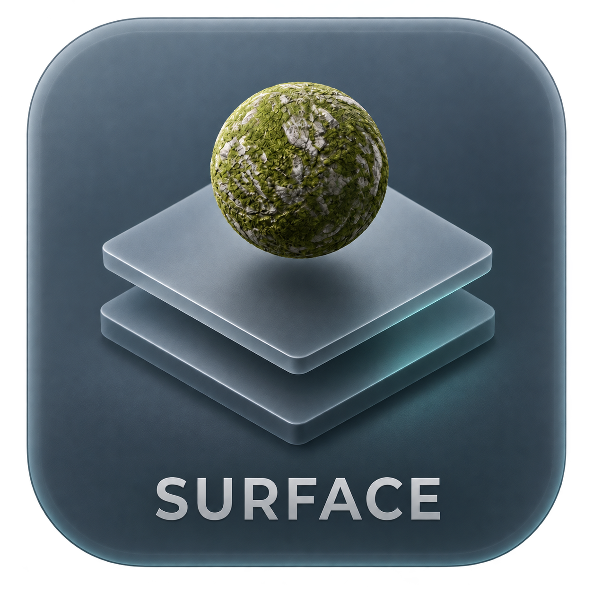
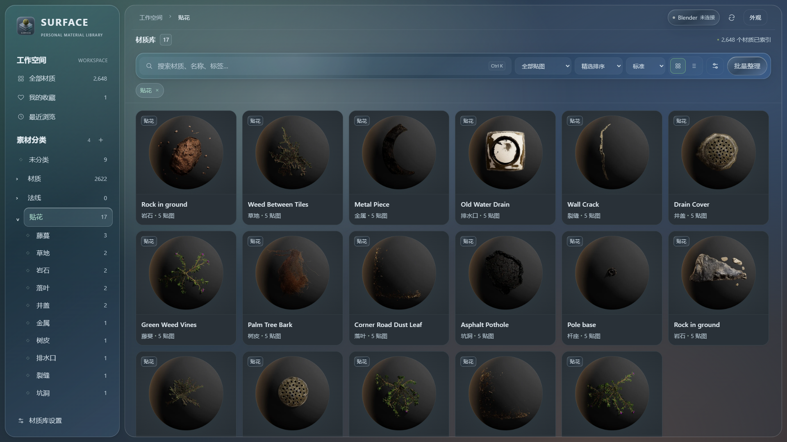
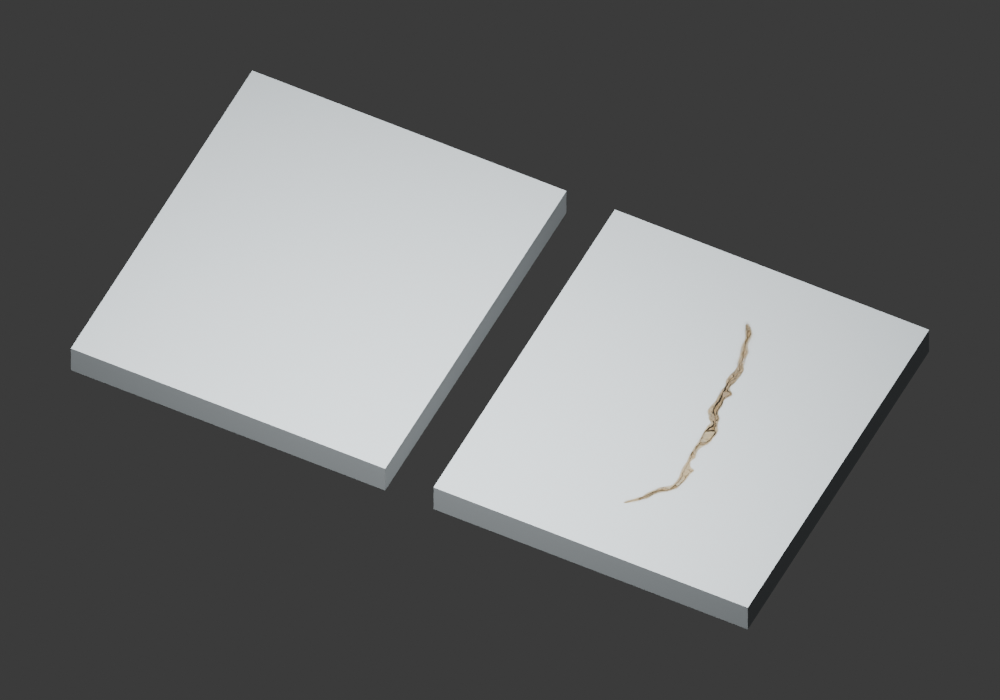
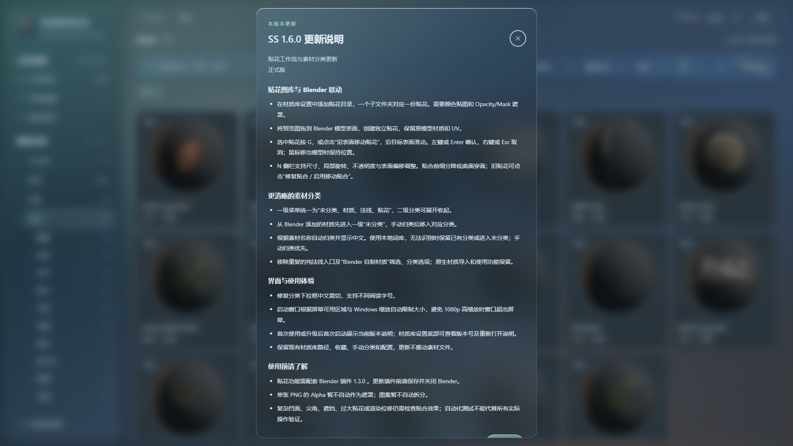
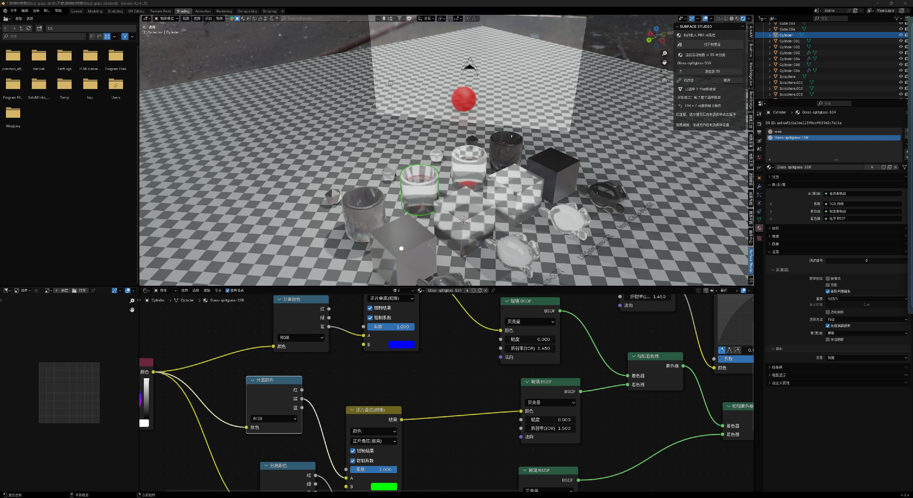
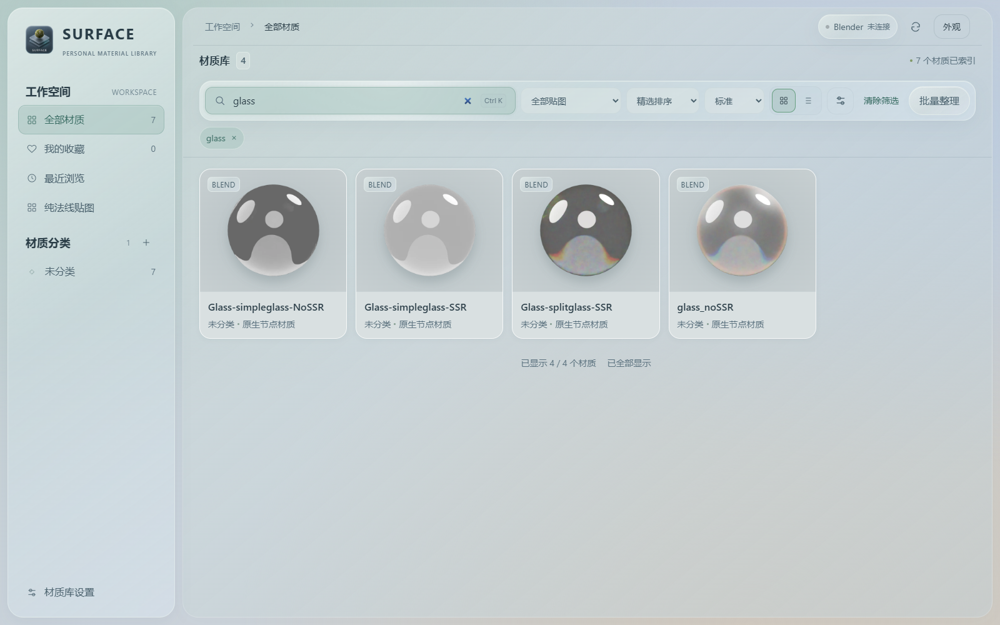
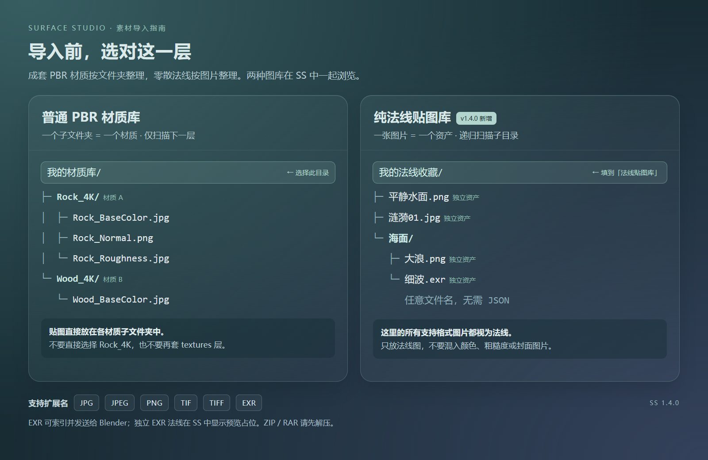
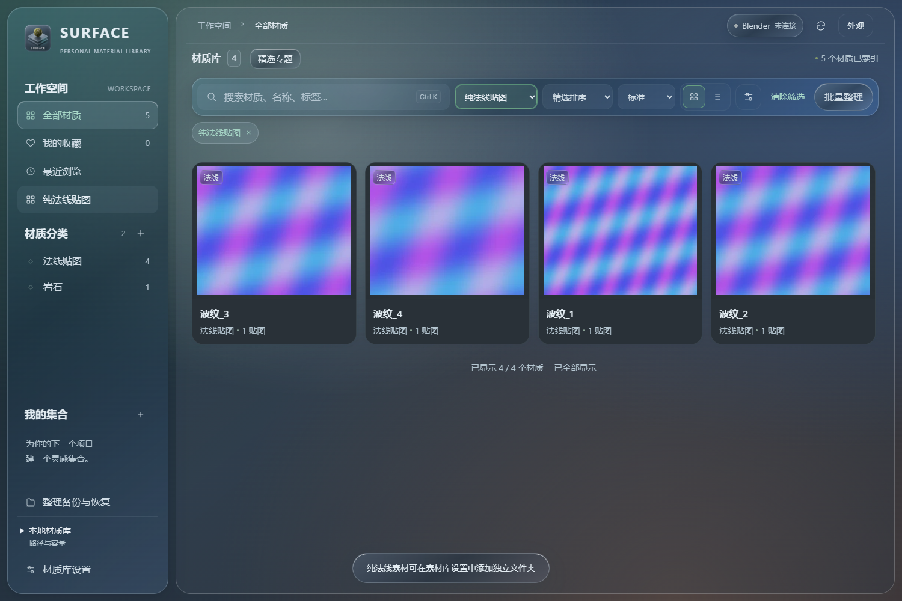
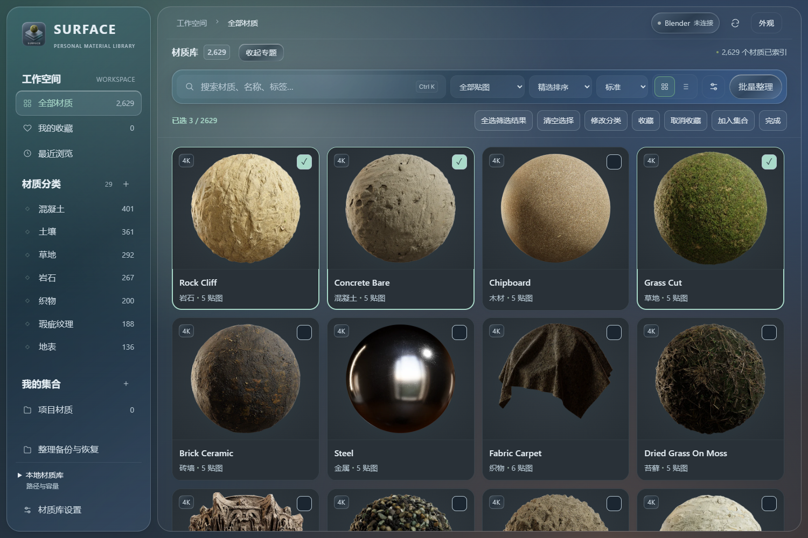
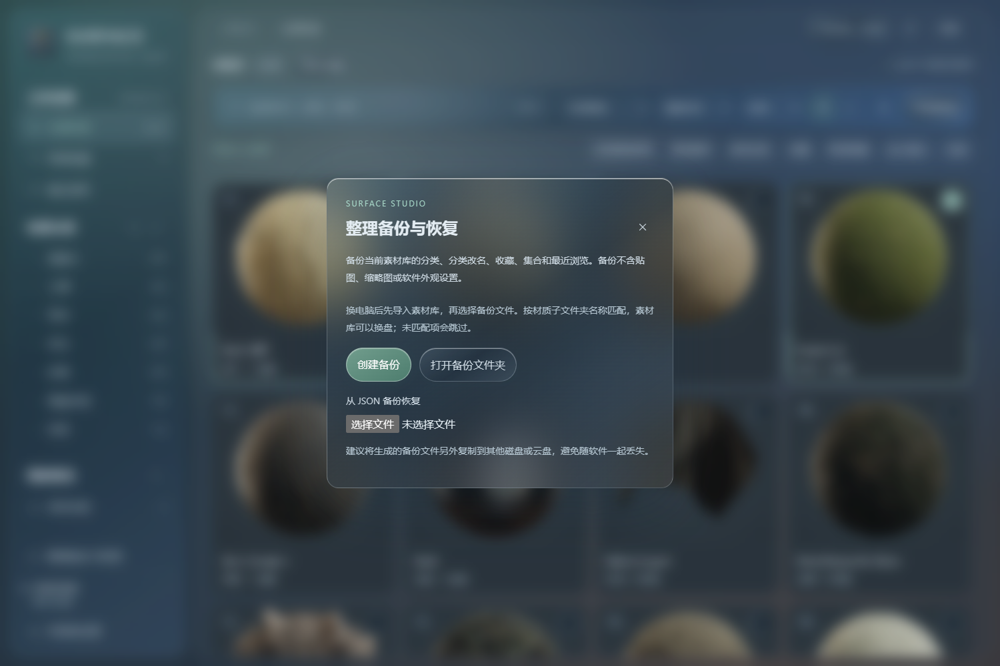

<p align="center"></p>

# Surface Studio

**本地 PBR 材质管理器，让材质库与 Blender 创作工作流连接。**

Surface Studio（SS）是一款 Windows 桌面工具，读取已有材质文件夹，提供预览、搜索、分类、收藏和对比，并通过配套 Blender 插件给模型或选中的面赋材质。青灰磨砂玻璃界面、一体化无边框窗口，无需登录账号或上传素材。

## 1.6.0 图文更新：贴花、素材分类与界面适配

**当前版本：SS 1.6.0 / Blender 插件 1.3.0 · 2026-10-29**

[下载安装包](https://github.com/XXLDinosaur/SurfaceStudio/releases/tag/v1.6.0) · [完整更新说明与验证边界](releases/v1.6.0.md)

### 素材分类：未分类、材质、法线、贴花

左侧“材质分类”更名为“素材分类”，一级菜单统一为 **未分类、材质、法线、贴花**。二级分类支持展开收起，根据素材名称自动归类并显示中文，例如 `Wall Crack → 裂缝`、`Drain Cover → 井盖`。

从 Blender“添加到 SS”的材质先进入一级“未分类”，手动归类后移入对应分类。手动分类优先保留；英文识别使用本地词库，无法识别的名称保留已有分类或进入未分类。取消重复的纯法线入口及“Blender 自制材质”筛选／分类选项，原生材质功能保留。



### 贴花拖到模型表面，保留原材质

在材质库设置中添加贴花图库，再把预览图拖到 Blender 对象模式下的模型表面，创建独立贴花对象，**不替换原模型材质、不修改原模型 UV**。

选中贴花按 **G**，或点击“沿表面移动贴花”，沿鼠标指向的表面滑动；左键／Enter 确认，右键／Esc 取消。N 侧栏 → Surface Studio → 贴花调整，可修改尺寸、局部旋转、不透明度和表面偏移。旧贴花可点击“修复贴合 / 启用移动贴合”升级曲面贴合。



一份贴花一个文件夹，需要颜色图和 Opacity/Mask 遮罩。单张 PNG 的 Alpha 暂不自动识别，图集暂不拆分；复杂凹面、尖角、过大的贴花或渲染位移仍需检查并调整。详见 [贴花使用说明](docs/decals.md)。

### 首次启动更新说明与设置底部版本号

首次使用或升级后的首次启动会展示本版本详细更新说明，同一版本关闭后不重复弹出。**材质库设置最底部显示当前版本号**，并提供“本版本更新说明”入口，随时可以重新查看。



### 1080p 与 Windows 缩放适配

启动窗口按所在屏幕的可用区域和 DPI 自动限制大小，最小窗口尺寸同步调整，避免高缩放时撑出屏幕。保留原有字体、青灰色玻璃界面和窗口圆角，并修复分类下拉框中文字裁切。

已模拟检查 1080p 下 100%、125%、150% 缩放及标准／大字号界面，并在当前显示器验证原生窗口尺寸；真实 1080p 显示器仍待进一步实测。高缩放配合大字号时布局会更紧凑，长设置与说明可滚动查看。

## 1.5.0：Blender 材质反向入库与软件更新

SS 1.5.0 / 插件 1.2.2 新增“添加到 SS”：直接保存到 SS 设置的位置（默认跟随当前材质库），自动进入“未分类”。保留静态节点、节点组及内嵌贴图，无需手动导出再导入，重装后重新添加目录即可使用。使用步骤、迁移方法与支持范围见 [Blender 自制材质保存指南](docs/blender-material-export.md)。

## 下载与启动

### 玻璃材质图文演示

使用玻璃材质示例，逐步说明 Blender 活动材质选择、添加到 SS、保存位置、未分类和再次赋予模型。查看 **[SS + Blender 操作图解](docs/glass-workflow.md)**。





1.5.0 加入了 GitHub 正式版本检查：在「材质库设置 → 软件更新」查看更新说明、下载校验后的安装包并确认安装。支持关闭自动检查；使用方式和发布签名流程见 [软件更新说明](docs/auto-update.md)。1.4.0 及更早版本需要先手动安装本版，以后才能在软件内更新。发现新版时，左下角材质库设置旁会显示“更新”。

从 **[Releases](https://github.com/XXLDinosaur/SurfaceStudio/releases/latest)** 下载 **SurfaceStudio-v1.6.0-Windows-x64-with-Blender.zip**。GitHub 的 Download ZIP 是源码，不是安装包。

合集包含 **SS 1.6.0 自动安装器、Blender 连接插件 1.3.0、中文安装说明与更新说明**。无需单独安装 Python；材质贴图由使用者自行准备。

1. 完整解压合集，运行 `SurfaceStudio-Setup.exe`。
2. 选择 SS 安装目录，勾选检测到的 Blender 版本。安装器会安装并启用配套插件、配置 SS 路径。
3. 打开 SS，在 **材质库设置** 中选择包含材质子文件夹的根目录并扫描。导入前请阅读 **[目录层级与格式说明](docs/import-materials.md)**，避免选错目录后扫描为 0。

要求 Windows 10 / 11 x64 和 Microsoft Edge WebView2 Runtime。自动安装支持已验证的 Blender **4.2、4.3、4.4、4.5 LTS、5.0、5.1、5.2 正式版系列**；自定义或便携安装可手动选择 `blender.exe`。其他版本暂不自动安装。WebView2 可从 [Microsoft 官方页面](https://developer.microsoft.com/microsoft-edge/webview2/) 获取。

**已有用户更新**：先关闭 Blender，并退出旧 SS 后台进程，再运行安装器，选择原 SS 目录。保留 `data` 文件夹；安装器会保留数据并备份旧程序和插件设置。详见 [安装说明](INSTALLER.md)。

**单实例**：重复双击只唤起现有窗口。点击右上角关闭按钮会隐藏窗口并保留后台 Blender 连接，再次启动恢复同一个窗口。

## v1.4.0 更新图解

新增独立纯法线贴图库，并补全导入层级与支持格式说明。先看 **[素材导入指南](docs/import-materials.md)**，完整更新见 **[v1.4.0 图文说明](releases/v1.4.0.md)**。





## v1.4.0：纯法线贴图库与导入指南

为收集水波、涟漪等零散法线图，**材质库设置** 新增可选的 **法线贴图库（每张图单独入库）**。指定目录后递归扫描，一张图片作为一个独立法线资产，文件名不必包含 `Normal`。可使用独立目录或普通材质库的专用子目录；不要选普通库本身或其上级，也不要混入颜色图、粗糙度图和封面图。

点击侧栏或顶部筛选中的 **纯法线贴图**，可以查看法线原图、平铺检视，并沿用收藏、集合、分类、批量整理和备份。已有 PBR 材质中仅含 Normal 通道的条目也会进入该筛选。EXR 可索引并将原文件发送给 Blender，SS 界面显示预览占位提示。

配套 Blender 插件仍为 **1.1.0**：赋予时生成连接法线图的基础新材质，不自动生成透明水材质，也不会给已有水材质叠加法线。具体目录示例、支持格式、EXR 限制和使用步骤见 **[素材导入指南](docs/import-materials.md)**。v1.3.0 没有独立法线图库入口；普通材质库的一层目录限制在 v1.4.0 中保持不变。

## v1.3.0 更新回顾

相比 v1.2.2，新增批量整理、整理记录备份与合并恢复，并统一了下拉菜单样式。完整对比和操作图见 **[v1.3.0 更新图解](releases/v1.3.0.md)**。





## v1.2.2：分类管理与柔和日间模式

侧栏“材质分类”旁的 **+** 可创建分类。右键材质 → **修改分类**，或在详情中点击 **修改分类**，可以改归到已有分类，也可新建分类并归入；支持恢复自动分类。记录按素材库路径隔离，重扫及重启后保留，原始文件不移动。右键左侧分类名称可重命名，默认分类和自建分类均支持。

侧栏分组标题加大加重；日间模式采用较低亮度的灰青玻璃与中性灰预览背景，让浅色材质更容易辨认。


## v1.3.0：批量整理与备份

点击顶部“批量整理”，点选材质；Ctrl/Cmd 可直接进入多选，Shift 连选。“全选筛选结果”包含当前筛选下尚未滚动加载的材质。切换筛选后，不在结果内的选择会清除。支持批量改分类（含恢复自动分类）、收藏、取消收藏和加入已有集合；处理前会确认数量。批量模式不启动 Blender 拖拽。

侧栏底部“整理备份与恢复”→ 创建备份。JSON 保存在软件目录 `data/organization-backups`，可点击打开文件夹后复制到其他盘或云盘。它包含当前素材库的分类、改名、收藏、集合和最近浏览，不含原始贴图、预览缓存、外观偏好或 Blender 设置。

换电脑时先导入素材库，再选择 JSON 备份；普通材质按子文件夹名称匹配。v1.4.0 的独立法线资产按相对于法线图库根目录的文件路径（含文件名）匹配，与普通材质区分；盘符可改变，但相对路径或名称改变后无法匹配。恢复前显示匹配和跳过数量。当前版本采用合并恢复：保留当前已有的手动归类和分类改名，补充收藏与集合，不删除当前整理结果；这不是覆盖还原到历史快照。未匹配的材质记录不导入，可保留备份文件等素材补齐后再次恢复。

批量操作与恢复前自动创建备份。请定期将备份复制到软件目录以外；它不能代替原始贴图备份。

## 功能

**保留的 Blender 与桌面功能**：自动检测并安装 Blender 插件；拖动材质球到 Blender 模型上赋材质；拖到其他程序时取消；重复启动只唤起已有窗口。完整记录见 [更新日志](CHANGELOG.md)。

| 功能 | 说明 |
| --- | --- |
| 本地索引 | 材质子目录、Quixel / Megascans 元信息、PBR 贴图与预览 |
| 纯法线图库 | v1.4.0：专用目录递归读取、一图一资产、原图 / 平铺检视、纯法线筛选 |
| 搜索筛选 | 名称、标签、中英文关键词；分类、分辨率、通道和平铺筛选 |
| 浏览 | 紧凑、标准、大图、列表；固定搜索栏；滚动到底部自动加载 |
| 整理 | 手动归类、新建及重命名分类、恢复自动分类、收藏、最近浏览、自建集合 |
| 预览对比 | 已有材质球图、颜色贴图、平铺预览、放大、双材质对比 |
| 桌面交互 | 自定义右键菜单、打开目录、复制路径、窗口拖动与缩放 |
| 外观 | 浅色 / 深色，标准 / 舒适 / 大字字号 |
| Blender | Principled PBR 节点、对象或选中面赋材质、自动 UV、可选凹凸 |

顶部空白处拖动窗口，双击最大化或还原；右上角控制最小化、最大化和关闭。`Ctrl+K` 聚焦搜索，`Esc` 关闭详情或弹层。非输入状态下按 `F` 收藏当前材质。卡片大小和阅读字号独立设置。

## 素材目录

```text
我的材质库/
  Rock_4K/
    Rock_Preview.png
    Rock_4K_Albedo.jpg
    Rock_4K_Normal.jpg
    Rock_4K_Roughness.jpg
    Rock_4K_Displacement.jpg
    metadata.json            # 可选
  Concrete_4K/
    ...
```

选择包含各个材质子文件夹的目录，每个材质的图片直接放在子文件夹内。**普通材质库当前不递归扫描：不要直接选择只放贴图的目录，也不要在根目录和材质文件夹之间再套一层分类。** 支持中文路径；JSON 可选，但并非所有第三方 JSON 都兼容。新增或删除素材后重新扫描。

支持索引 **JPG / JPEG、PNG、TIF / TIFF、EXR**；EXR 预览受限。当前不导入 WebP、BMP、TGA、DDS、HDR，不解析 `.blend`、`.sbsar`，也不自动解压 ZIP / RAR。

目录示例、各格式预览能力、命名规则和扫描排查步骤见 **[素材导入指南](docs/import-materials.md)**。

原材质只读访问，不搬动、不重命名。材质球使用资源库已有预览图，**不是实时 PBR 渲染器**。普通材质的 EXR 预览依赖可用代理图；独立 EXR 法线资产显示占位提示。法线原图与平铺检视不等于水面材质的渲染效果。

## Blender 联动

### 拖拽赋材质（SS 1.1.4 + 插件 1.1.0）

Windows 桌面客户端和配套 Blender 插件都需要更新。启用插件并配置 SS 程序路径，在 Blender 对象模式下，按住 SS 的材质球，拖到视口中的网格表面松开。仅给落点模型赋材质，无需预先选中；空白处、锁定选择的对象和不可直接编辑的实例不会应用。支持 Ctrl+Z 撤销。

网页浏览器模式不支持此原生跨应用拖出。编辑模式选中面赋材质仍使用原有“赋予到 Blender”按钮。拖拽沿用当前平铺、AO、法线和自动 UV 选项。插件路径必须指向正在使用的 SS；可以运行新版自动安装器进行配置。

目标赋予、撤销及视口射线检测有自动化测试；完整的跨窗口鼠标手势已通过 Blender 4.2.4 LTS 用户手动验收，详见 [拖拽验证记录](DRAG-DROP.md)。GitHub 旧版便携包不会自动升级。

安装与插件功能已在 Blender 4.2.4、4.2.9、4.3.0、4.4.3、4.5.15 LTS、5.0.1、5.1.2、5.2.0 验证。完整跨窗口拖放由用户在 4.2.4 LTS 手动验收；其他版本尚未逐一手测完整鼠标操作。以下为不使用自动安装器时的手动安装方法。

1. 从 Release 下载 `surface_studio_bridge.zip`。
2. Blender → 编辑 → 偏好设置 → 插件 → 从磁盘安装，选择 ZIP 并启用。
3. 在插件偏好设置中指定实际的 `Surface Studio.exe` 路径。
4. 3D 视图按 `N` → Surface Studio，选中网格模型，点击“打开材质库”。
5. 在 SS 中选择材质、检查目标模型，点击“赋予到 Blender”。

对象模式赋予选中模型，编辑模式只作用于选中的面。支持颜色空间、AO、平铺、可选高度凹凸及 DirectX 法线翻转。原材质槽保留，赋予操作可以 `Ctrl+Z` 撤销。

贴图按本地路径引用，不自动打包进 `.blend`。移动工程时保持贴图可访问，或在 Blender 中打包外部资源。详见 [插件说明](blender_addon/surface_studio_bridge/README.md)。

## 源码运行

建议 Windows x64 + Python 3.12：

```powershell
python -m venv .venv
.\.venv\Scripts\python.exe -m pip install -r requirements.txt
.\.venv\Scripts\python.exe desktop.py
```

首次使用项目旁的 `materials` 目录，可在设置中更换。已有 `data/config.json` 优先于默认值。

只开发网页界面时运行 `python server.py`，浏览器访问 `http://127.0.0.1:47831`。浏览器模式不显示原生窗口按钮，无边框功能由 `desktop.py` 提供。

## 打包

后续每次发布须同时提供 SS 与对应 Blender 插件的合集、独立插件安装包及校验文件；合集内附中文启动、插件安装、连接和更新说明，并标明两者版本与 Blender 兼容范围。分发包不得包含个人素材或 `data`。

### 自动安装 Blender 连接

新增 `SurfaceStudio-Setup.exe` 安装器，检测 Blender 后可一次安装 SS、启用连接插件并配置程序路径。常规安装无需单独在 Blender 中安装插件；便携版可手动指定 `blender.exe`。详情与限制见 [安装说明](INSTALLER.md)。安装器内置 SS v1.4.0 与插件 v1.1.0，包含视口拖拽赋材质。

先构建 SS EXE，再执行 `./build_installer.ps1 -Python ./.venv/Scripts/python.exe`。输出 `dist/SurfaceStudio-Setup.exe`。安装器只包含显式列出的软件、插件和说明文件，不复制个人数据。

安装测试：`python -m unittest test_installer`；真实 Blender 隔离配置测试：`python test_installer_blender.py "路径/blender.exe"`。后者验证安装、重启启用、更新路径、偏好保留、失败回退与 PBR 功能，不写入真实 Blender 用户配置。

```powershell
.\.venv\Scripts\python.exe -m pip install -r requirements-dev.txt
.\build.ps1 -Python .\.venv\Scripts\python.exe
.\.venv\Scripts\python.exe package_addon.py
```

EXE 输出到 `dist/Surface Studio.exe`，插件输出为 `surface_studio_bridge.zip`。PyInstaller 需要在 Windows 上构建。分发时不要包含个人 `data`、浏览器配置或素材文件。

## 测试

```powershell
.\.venv\Scripts\python.exe -m unittest test_normal_library test_server test_bridge test_installer test_drag test_material_drag test_single_instance
& '你的Blender安装目录\blender.exe' --background --factory-startup --python-exit-code 1 --python test_blender.py
```

服务和消息邮箱测试使用临时目录。Blender 测试使用工厂启动配置，不操作自己的模型或偏好设置。开发期间还检查过搜索、列表、筛选、右键、字号和真实原生窗口控制；这些界面检查依赖本机环境，尚未配置跨平台 CI。

## 数据与隐私

| 位置 | 内容 |
| --- | --- |
| `data/config.json` | 素材库路径 |
| `data/categories.json` | 手动分类与自定义分类，按素材库路径隔离；建议备份 |
| `data/state.json` | 收藏、集合、最近浏览；建议备份 |
| `data/index.json` | 可通过扫描重建的索引 |
| `data/thumbnails/` | 可重建的缩略图缓存 |
| `data/webview-profile/` | 主题与字号等浏览器状态 |
| `data/blender/` | Blender 本地连接和请求文件 |

服务只监听本机 `127.0.0.1:47831`，不要直接暴露到公网。仓库不包含真实素材库、收藏、浏览记录或本机配置。软件运行不要求云服务，安装依赖和下载版本需要网络。

## 常见问题

- **无法启动**：检查 WebView2 Runtime、目录写权限，以及 47831 端口是否被占用。
- **更新后还是旧界面**：退出旧 SS 后台进程再启动新版。
- **Blender 未连接**：检查插件启用状态和 EXE 路径，从 Blender 侧栏打开材质库。
- **没有缩略图**：检查预览图是否存在；EXR 需要可用代理图。
- **扫描为 0 / 缺少材质**：先检查 [目录层级、支持格式与 JSON 说明](docs/import-materials.md)。普通材质库当前只读取根目录下一层材质文件夹中的图片。
- **主题或字号重置**：从旧 Edge 独立窗口迁移到 WebView2 需重新选择一次，收藏不受影响。

## 项目结构

```text
desktop.py             # WebView2 桌面宿主
server.py              # 本地服务、索引、图片预览
blender_bridge.py      # Blender 消息邮箱
public/                # 界面与图标
blender_addon/         # Blender 插件
build.ps1              # EXE 打包
package_addon.py       # 插件打包
```

当前面向 Windows 和 Blender，没有 Revit 或 SketchUp 直接赋材质插件，不提供云同步、素材下载或材质授权。使用者需自行准备有权使用的资源。

## 许可与说明

Copyright (C) 2026 XXLDinosaur。项目原创代码（包括 SS 客户端和配套 Blender 插件）采用 **[GNU GPL v3.0](LICENSE)**，许可证标识为 `GPL-3.0-only`。

- 允许个人使用、商业使用、修改和收费分发。
- 分发原版或修改版时，须遵守 GPLv3，保留版权、许可及无担保声明；修改版须注明修改情况，并按 GPLv3 向接收者提供完整对应源码（包括必要的构建、安装脚本）。不能只提供 EXE 而不履行源码提供义务。
- 仅私下使用、不分发的修改，无须公开。使用本软件制作的模型和作品不会仅因使用本软件而被要求开源。
- 软件按现状提供，不作担保。上述为便于理解的摘要，以 LICENSE 完整条款为准。

第三方依赖保留各自的版权和许可证，本项目许可不替代它们的条款。用户自己的材质、贴图和项目文件不属于本项目的许可范围。图标基于设计参考经 AI 辅助制作；软件名称和标识不代表对修改版的官方认可。本项目与 Quixel / Epic Games / Blender Foundation 无隶属关系。

新增版本的测试范围与限制见 [Blender 兼容性补测](docs/blender-compatibility.md)。
