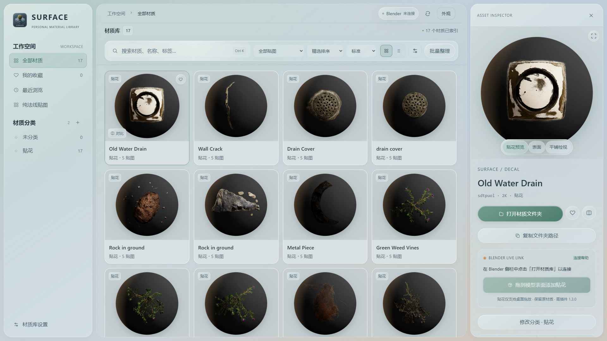

# 贴花：把局部污渍拖到模型表面

SS 1.6.0，配套 Blender 插件 1.3.0。

## 导入

在 **材质库设置 → 贴花图库** 中填写贴花根目录并扫描，例如 `K:\workspace\贴花`。

```text
贴花图库/
  裂缝_2K/
    crack_2K_Albedo.jpg
    crack_2K_Opacity.jpg
    crack_2K_Normal.jpg
    crack_2K_Roughness.jpg
    crack_Preview.png
```

一个子文件夹对应一张贴花。颜色图（Albedo/BaseColor/Diffuse）和透明遮罩（Opacity/Mask）必需，法线、粗糙度等可选。支持 JPG、JPEG、PNG、TIF、TIFF、EXR；EXR 在 SS 中只显示占位预览。当前不把单张 PNG 的 Alpha 自动当作遮罩。

原文件保留在你选择的目录中，软件重装后重新填写目录即可扫描。缺少必需贴图的文件夹会跳过，并列入扫描提示。



## 使用

1. 打开 Blender，启用配套插件，在对象模式显示目标网格。
2. 在 SS 的「贴花」分类中，按住预览图拖到 Blender 模型表面后松开。
3. 插件在鼠标落点创建独立贴花对象，按表面法线定向并贴合表面；模型原有材质保持不变。
4. 选中贴花，在 **N 侧栏 → Surface Studio → 贴花调整** 修改尺寸、旋转、不透明度、表面偏移。可用 S 缩放、X 删除，或 Ctrl+Z 撤销。

选中贴花后按 **G**，或点击「沿表面移动贴花」，沿鼠标指向的目标模型表面移动，并连续调整朝向。左键或 Enter 确认，右键或 Esc 取消；鼠标移出模型时保留最后有效位置。绕到球体另一面时，先确认、切换视角，再继续移动。该操作只用于对象模式下的 SS 贴花；普通模型仍使用 Blender 原来的 G 操作。旧版已创建的贴花也可使用此移动方式；防穿面升级仍需点击「修复贴合 / 启用移动贴合」。局部旋转请使用面板中的「旋转」。复杂遮挡、不连续表面和过大的贴花仍需人工检查；原生移动工具或直接编辑坐标不使用此表面滑动逻辑。

贴花会跟随目标对象移动。使用材质预览或渲染模式查看透明效果；拖入时会从实体模式切到材质预览。

下面为独立测试场景的实际渲染：左侧保留原材质，右侧叠加裂缝贴花，背景通过透明遮罩露出原材质。


## 当前边界

贴花创建流程统一增加投射前细分与按尺寸计算的表面间距，降低曲面上面片穿入模型造成的条状破面；从自选文件夹导入的贴花也走同一流程。旧贴花在「贴花调整」使用「修复贴合 / 启用移动贴合」升级，支持撤销。此保护不能保证任意尖锐、凹陷或渲染时位移的表面都无穿插，必要时仍需调整尺寸和表面偏移。

- 需要 Windows 桌面客户端的跨窗口拖放；普通「赋予到 Blender」按钮不用于贴花。
- 适合平面、墙面及缓弯曲面；尖锐转角、薄壳背面、复杂凹面可能需要手动调整大小和偏移。
- 图集先整张导入，尚未自动拆分其中的多个图案。
- 不修改模型 UV，也不会把裂缝烘焙到原材质里；贴花是独立网格及材质。
- 旧插件拒绝新版贴花拖放数据，不会把它误当普通材质覆盖原材质。
