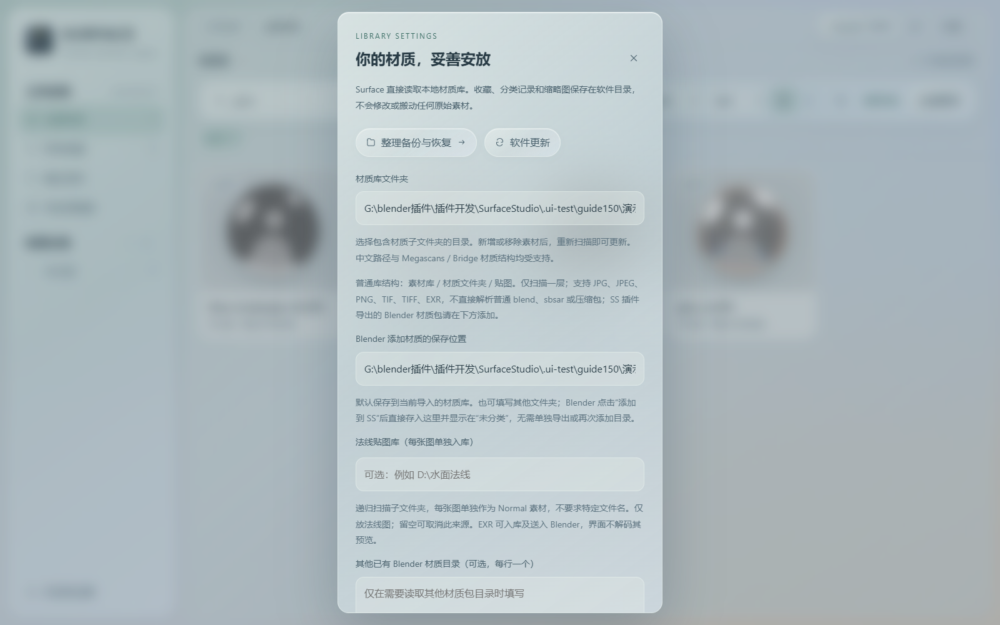
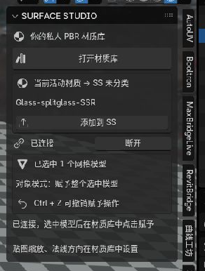
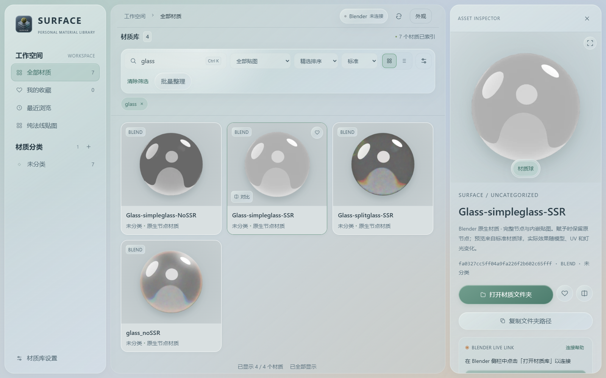

# 玻璃材质：从 Blender 保存到 SS，再重复使用

以下使用用户提供的“玻璃材质集合 test-glass-all”示例说明。Blender 截图来自已打开的 4.2 场景；SS 截图来自独立演示库，预览使用同一示例文件中的材质生成。只展示使用流程，不提供示例模型或材质文件下载。

## 1. 先在 SS 设置保存位置

打开左下角 **材质库设置**，确认“材质库文件夹”和“Blender 添加材质的保存位置”。后者留空时跟随前者，也可以填写另一个长期保存的目录。



图中使用独立演示目录，实际使用请填写自己的素材盘目录。建议放在软件安装目录以外；重装 SS 时保留这份材质目录即可。无需先导出到桌面，再手动搬进 SS。

## 2. 在 Blender 选择要收藏的活动材质

选中模型，再在材质槽中选中想保存的材质。一个模型有多个材质时，**“添加到 SS”保存当前活动材质，不是一次保存模型全部材质槽**。


截图中选中的是玻璃杯，活动材质为 `Glass-splitglass-SSR`。下方可看到原有材质节点；右侧插件面板也会显示当前活动材质名称。

## 3. 点击“添加到 SS”

在 Blender 的 3D 视图按 **N → Surface Studio**。保持 SS 运行，确认面板显示的材质名正确，然后点击 **添加到 SS**。软件会生成材质预览并将它加入 SS 的“未分类”。生成预览需要一点时间，请等待完成提示。



- **打开材质库**：打开 SS 并建立连接。
- **当前活动材质 → SS 未分类**：下方名称就是本次要保存的材质。
- **添加到 SS**：直接保存到 SS 设置的目录。
- **已连接 / 已选中 1 个网格模型**：显示连接状态及当前可接收赋材质操作的选择。

## 4. 在 SS 浏览和整理

进入置顶的 **未分类**，或搜索材质名称。示例搜索 `glass` 后显示四种玻璃材质；`BLEND` 标签表示保留了 Blender 原生节点，并不是把材质转换成普通 PBR 贴图。


右键材质可修改分类、重命名或加入对比；双击名称可直接原位修改。重命名同时改变对应文件夹名称，其他工程若引用旧路径，需要重新定位。

## 5. 查看详情，再赋予 Blender 模型

点击卡片打开详情，可以预览材质、收藏、打开材质文件夹或复制路径。保持 Blender 已连接并选中目标网格，再在详情的 Blender 联动区域点击 **赋予到 Blender**；Windows 桌面客户端也支持拖到视口中的目标网格。



这张 SS 截图使用独立演示库，因此显示“Blender 未连接”，不是连接成功后的截图。实际操作时可点顶部 Blender 状态按钮请求连接，或在 Blender 插件面板点击“打开材质库”。对象模式的按钮赋予作用于选中的网格，编辑模式作用于选中的面；可在 Blender 按 **Ctrl+Z** 撤销。

玻璃受模型厚度、背景、灯光和渲染器影响很大，SS 的标准材质球预览不保证与原场景完全相同。文件名里的 SSR / NoSSR 是示例材质原有名称，不表示 SS 会自动配置场景渲染设置。

## 6. 换电脑或重装后怎么保留

每个保存的材质都有自己的目录：

```text
你的自制材质库/
└─ Glass-splitglass-SSR_唯一标识/
   ├─ material.blend          原生材质，包含节点及打包图片
   ├─ preview.png             SS 预览
   └─ surface-material.json   SS 识别信息
```

备份整个材质目录，重装后在 SS 设置中选择该库并扫描即可，不要只复制预览图。原生材质需要相同或更高主次版本的 Blender；例如由 5.2 保存的材质不能发送到 4.2。SS 演示预览使用 5.2 生成，日常使用请直接在自己的 Blender 版本中保存。

更多内容：[完整保存范围](blender-material-export.md) · [兼容性测试](blender-compatibility.md) · [软件更新](auto-update.md)。
