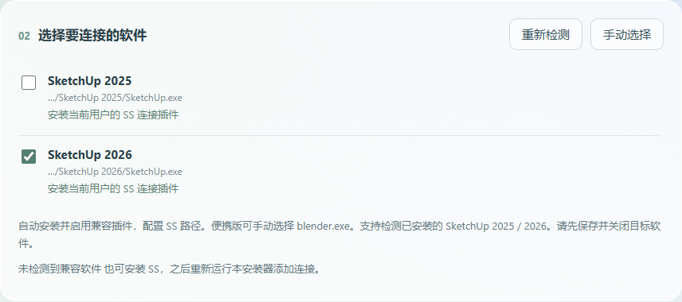

## 1.7.0 · 从 SS 拖到 SketchUp 或 Blender

[下载 Windows 安装器](https://github.com/XXLDinosaur/SurfaceStudio/releases/download/v1.7.0/SurfaceStudio-Setup.exe) · [单独下载 SketchUp 插件](https://github.com/XXLDinosaur/SurfaceStudio/releases/download/v1.7.0/SurfaceStudio-SketchUp.rbz) · [单独下载 Blender 插件](https://github.com/XXLDinosaur/SurfaceStudio/releases/download/v1.7.0/surface_studio_bridge.zip)

1. **选版本。** 安装器从 Windows 安装记录识别 SketchUp 2025 和 2026，并检查程序是否存在。只装一个就只列一个，同时安装可分别勾选。以后安装 SU 2026，重新运行安装器即可补装。
2. **拖放材质。** 安装完成后重新打开 SketchUp，在 SS 桌面窗口按住材质预览图，拖到模型上松开。Blender 和 SU 同时运行时，松开鼠标的位置决定接收窗口。SU 支持普通 PBR 和纯法线材质，在目标软件中按 Ctrl+Z 可撤销。
3. **从 SU 入库。** 选中带贴图材质的面，在扩展程序菜单选择「Surface Studio · 添加材质到 SS」，然后在 SS 中重新扫描。贴花及 Blender 原生节点材质使用 Blender 工作流。

上图使用模拟双版本安装记录展示选择方式。本机实测识别 SU 2025，且收到了 SU 2025 的赋材质成功回执。SU 2026 已通过模拟安装、版本隔离和旧插件备份测试，实际模型拖放仍待 2026 真机验证。
