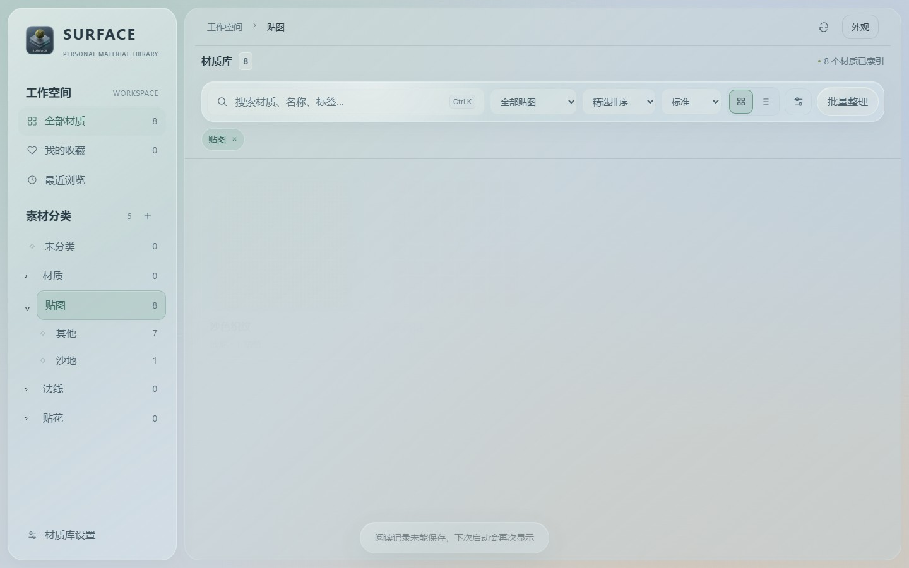

## 1.7.1 · 单张贴图材质库

[下载 Windows 安装器（内含两款插件）](https://github.com/XXLDinosaur/SurfaceStudio/releases/download/v1.7.1/SurfaceStudio-Setup.exe) · [全部下载与校验文件](https://github.com/XXLDinosaur/SurfaceStudio/releases/tag/v1.7.1)

### ① 设置贴图所在的文件夹

打开左下角 **材质库设置**，找到 **贴图库（每张图单独入库）**，填入存放普通颜色图片的目录，点击 **保存并重新扫描**。原有 PBR 材质库可以继续使用。独立贴图库会递归读取子目录，每张图片都是一个素材，无需先建八个文件夹或给文件名加上 Albedo。

### ② 打开左侧「贴图」，直接拖到模型

下图是 SS 1.7.1 的实际界面，使用八张自制示例纹理。点左侧 **贴图**，每张图片分别显示名称和预览。按住卡片里的预览图，拖到 SketchUp 模型表面或 Blender 对象模式下的网格上松开。单张图片作为材质的颜色贴图使用，不需要配齐法线、粗糙度或金属度贴图。想撤销时，到接收软件按 **Ctrl+Z**。

如果「贴图」显示 0，先检查设置中的**贴图库路径**是否指向图片实际所在目录，再保存并扫描。纯法线图应放在「法线贴图库」，需要遮罩的贴花应放在「贴花图库」。详情栏已移除旧的 Blender Live Link 面板，直接从卡片或详情预览图拖出即可。

**验证范围**：使用真实 SS 拖放任务，在 SketchUp 2025 和 Blender 4.2 的独立测试模型中分别验证八张图片，逐张确认模型材质引用正确原图，包括中文文件名和同名不同扩展名。本轮验证覆盖插件接收与赋材质，未重测完整的跨窗口鼠标手势。
