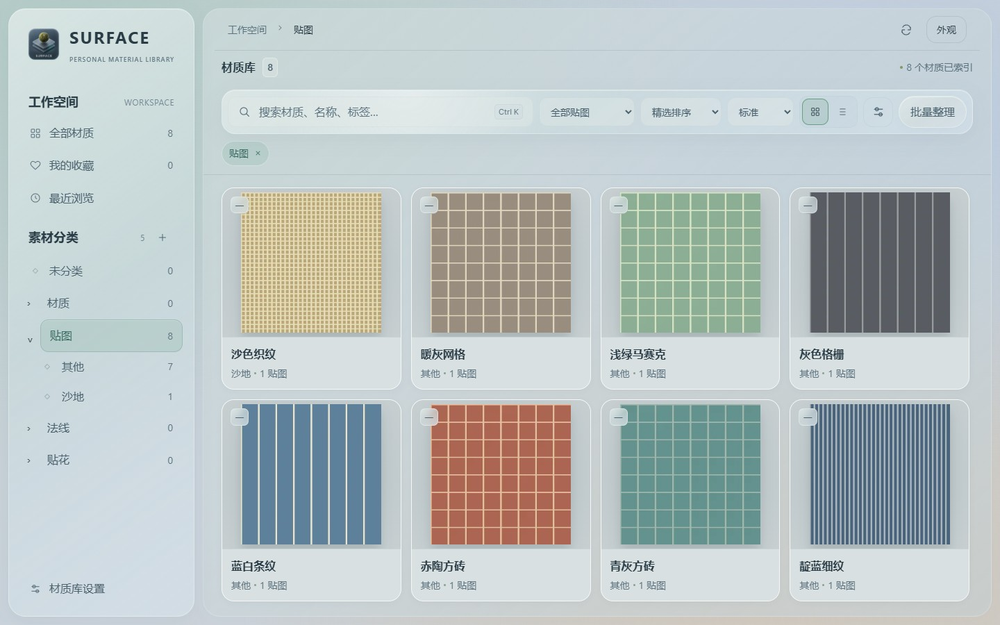
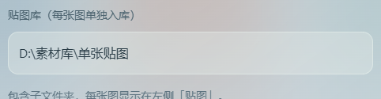
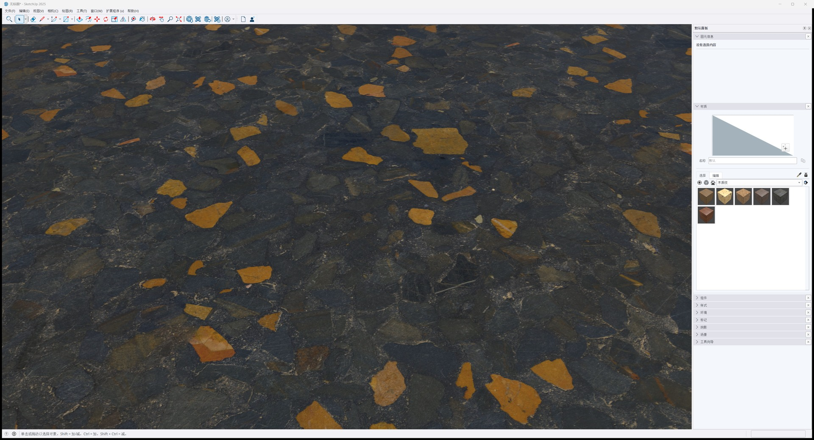

## 1.7.2 · 支持 SketchUp 2023 / 2024

[下载 Windows 安装器（含 Blender 与 SketchUp 插件）](https://github.com/XXLDinosaur/SurfaceStudio/releases/download/v1.7.2/SurfaceStudio-Setup.exe) · [独立插件与校验文件](https://github.com/XXLDinosaur/SurfaceStudio/releases/tag/v1.7.2)

SS **1.7.2**，SketchUp 插件 **0.2.1**，Blender 插件保持 **1.3.1**。安装器现在识别实际安装的 SketchUp **2023、2024、2025、2026**，可分别勾选；不会为未安装的版本创建插件目录。更新前保存并关闭接收软件，安装后重新打开。

| SketchUp 版本 | 单张贴图 / 颜色贴图 | PBR 附加通道 | 验证范围 |
| --- | --- | --- | --- |
| 2023 / 2024 | 支持，拖到面、组或组件 | 自动跳过法线、粗糙度、金属度、AO；纯法线素材提示不支持 | 模拟安装、版本隔离及旧版 API 行为测试；尚无这两个版本的真机拖放验证 |
| 2025 / 2026 | 支持 | 使用软件支持的 PBR 接口 | 2025 既有真实模型接收测试；2026 模拟安装测试 |

旧版 SU 本身没有原生 PBR 材质接口，因此带多张贴图的材质在 2023 / 2024 中使用颜色图，不能呈现 2025 的全部 PBR 效果。仅含法线的素材不会创建空白材质，也不会覆盖原材质。导出材质回 SS 时同样跳过旧版不存在的接口。[SketchUp 官方材质 API](https://ruby.sketchup.com/Sketchup/Material.html)

### 安装与拖放

1. 运行新版安装器，勾选检测到的 SU 版本；已有插件先备份再更新。也可从发布页下载 RBZ，在各版本的扩展程序管理器中手动安装。
2. 打开 SS，在「材质库设置 → 贴图库」填入单张图片目录，保存并重新扫描。每张图片独立入库，不要求 PBR 命名。
3. 打开 SU 模型，按住 SS 素材卡片的预览图，拖到模型表面松开；在 SU 按 Ctrl+Z 可撤销。多个建模软件同时打开时，拖入哪个窗口就由哪个接收。

下面为此前 **SketchUp 2025 真机截图**，用于说明拖放后的贴图效果，不是 2023 / 2024 的实测截图。

本轮通过 68 项后端测试，以及 Ruby 旧版材质接口模拟测试（颜色图赋予、纯法线无副作用拒绝、PBR 通道回归）。模拟测试不等同于旧版本实际窗口中的完整鼠标拖放验证。更新保留素材、收藏和配置。

