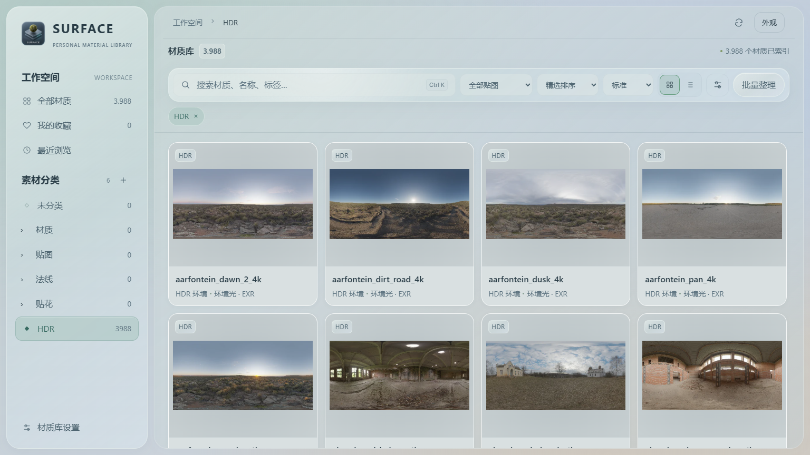
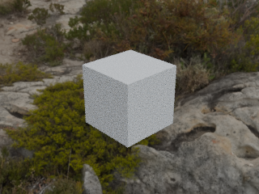

# Surface Studio 1.8.0

SS 1.8.0 / Blender 插件 1.4.0 / SketchUp 插件 0.2.1。

## HDR 环境图库

设置独立 HDR 图库，读取 HDR/EXR 全景图。按名称自动分成天空、室内、摄影棚、街道、森林、海边等组，后续扫描继续生效；手动分类优先保留。

从卡片预览图拖进 Blender 3D 视口即可应用世界环境，空白处也能接收。Cycles/Eevee 正式渲染使用原图，支持撤销/重做，保留原 World 与其他场景。

## 预览缓存与兼容性

后台预生成、磁盘与内存缓存、并发合并，重启后复用；原图变化后更新。修复空自定义分类重复出现在所有素材类型中的问题。

Blender 4.2、4.3、4.4、4.5、5.0、5.1、5.2、5.3 均通过隔离安装、修复/回滚、PBR、原生材质、贴花、HDR/EXR 与渲染测试。完整跨窗口鼠标手势未逐版本实测；HDR 不支持 SketchUp。截图与渲染图均来自真实页面或独立渲染，不是旧版软件的伪造截图。

推荐下载 SurfaceStudio-Setup.exe，含软件与两款插件；单独 Blender 插件为 surface_studio_bridge.zip，SU 为 SurfaceStudio-SketchUp.rbz。Surface Studio.exe 为独立软件，不含个人数据或素材。更新前保存关闭接收软件并退出 SS 后台，选择原目录安装以保留配置。

[完整图文步骤](https://github.com/XXLDinosaur/SurfaceStudio#readme) · [验证记录](https://github.com/XXLDinosaur/SurfaceStudio/blob/v1.8.0/docs/blender-1.8.0-validation.md)
