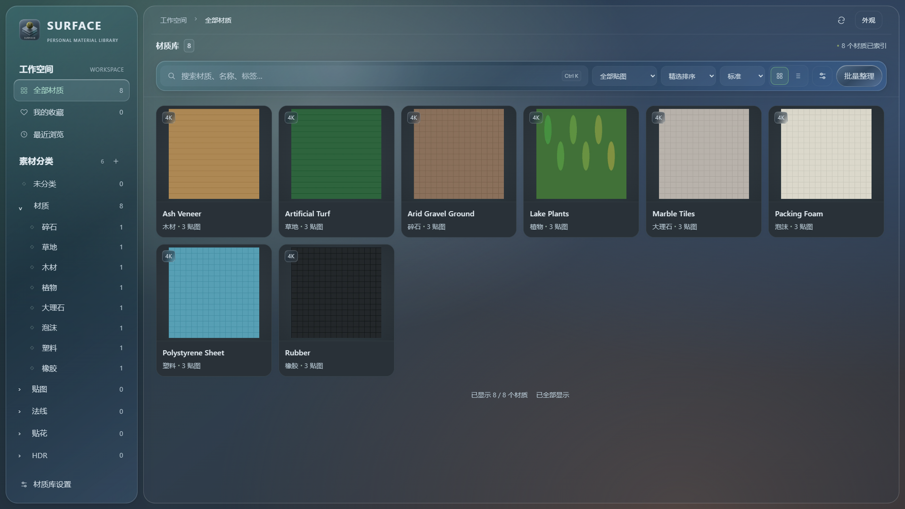
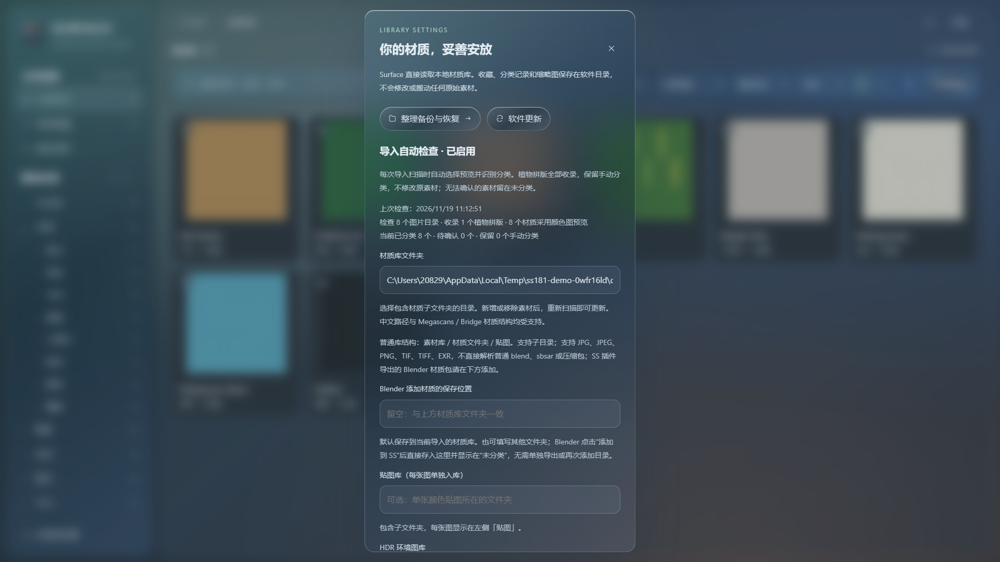

# Surface Studio 1.8.1

本版内置导入检查，修正部分素材误用 AO 图导致的白色预览，扩充离线自动分类。植物拼版全部收录，保留收藏、配置和手动分类。

截图使用临时演示图库和自制纹理，不包含用户私人素材。

## 使用方法

1. 下载并运行 SurfaceStudio-Setup.exe，选择原安装目录；保留原有 data。更新接收插件前保存并关闭对应软件。
2. 将新素材放入已配置的图库，点击顶部刷新，或在材质库设置中保存并重新扫描。
3. 在材质库设置的“导入自动检查”查看预览、植物拼版收录及分类结果。软件不实时监视文件夹。

软件优先使用自带 Preview，没有 Preview 时优先使用颜色图。名称词库结合素材类别、目录和标签自动分类，手动分类优先；无法确认的素材留在未分类。旧索引后台升级一次，正常重启复用检查记录。

## 下载附件

- SurfaceStudio-Setup.exe：Windows 安装器，内含软件与两款插件。
- Surface.Studio.exe：独立主程序。已有用户应保留 data；全新用户优先使用安装器。
- surface_studio_bridge.zip：Blender 插件 1.4.0。
- SurfaceStudio-SketchUp.rbz：SketchUp 插件 0.2.1。
- surface-update.json、surface-update.sig：自动更新清单与签名。
- SHA256SUMS.txt：附件校验。

## 验证范围

95 项 Python 后端测试通过，1920×1080 隔离界面与检查结果通过脚本验证。接收端插件代码未变化；Blender 4.2–5.3 验证沿用 1.8.0 记录，本轮没有重跑八版本矩阵或完整鼠标跨窗口拖放。

HDR 仅支持 Blender；本版没有 D5 直连接入。更多图文操作见 README。
